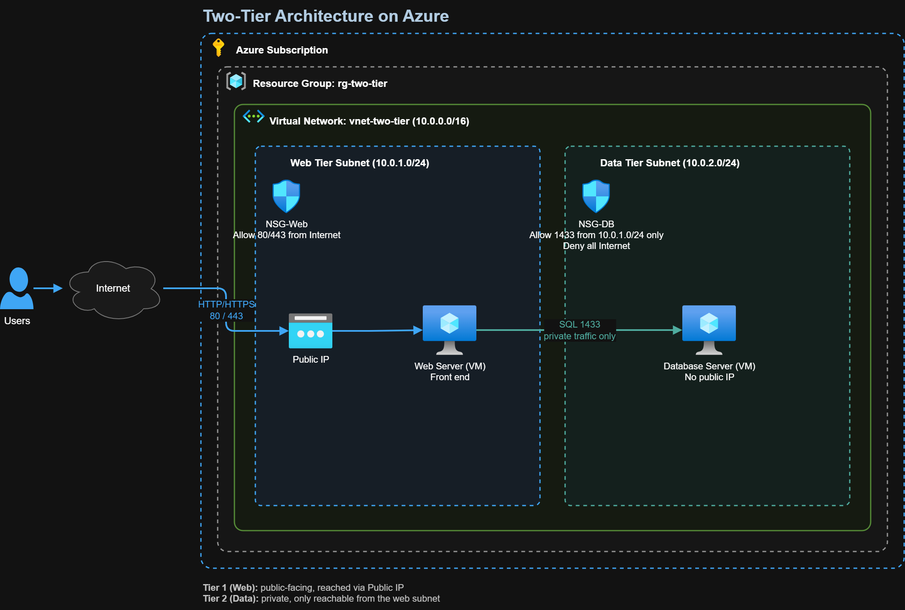

# Lab 02: Two-Tier Architecture on Azure

A two-tier design with a public web tier and a private data tier, built with security-first principles.

## 🎥 Video Walkthrough
[▶️ Watch the walkthrough on Loom](https://www.loom.com/share/d20b000f0d9a432b8fb083ac12a03afd)

## 📐 Architecture Diagram

## 🏗️ Components
| Component | Details |
|---|---|
| Virtual Network | vnet-two-tier, 10.0.0.0/16 |
| Web Tier Subnet | 10.0.1.0/24, Web Server VM with a Public IP |
| Data Tier Subnet | 10.0.2.0/24, Database Server VM with no public IP |
| NSG-Web | Allows HTTP/HTTPS (80/443) from the internet |
| NSG-DB | Allows SQL (1433) only from 10.0.1.0/24; denies internet traffic |

## 🔄 Traffic Flow
User → Internet → Public IP → Web Server → (private) → Database Server

## 🔐 Why This Design
- **Security:** The database has no public IP, and NSGs enforce least privilege.
- **Defense in depth:** An attacker must get past the web tier to reach the data.
- **Scalable:** Web servers can be added without changing the database.

## 📄 Documentation
- [Lab 02 slide deck (PDF)](LinkedIn_Carousel_Lab02_Two_Tier_Architecture.pdf)
- [Editable diagram (draw.io)](Azure_Two_Tier_Architecture.drawio)

## ⏭️ Next Steps
Deploy this architecture on Microsoft Azure and test that the web tier works while the database stays private.
